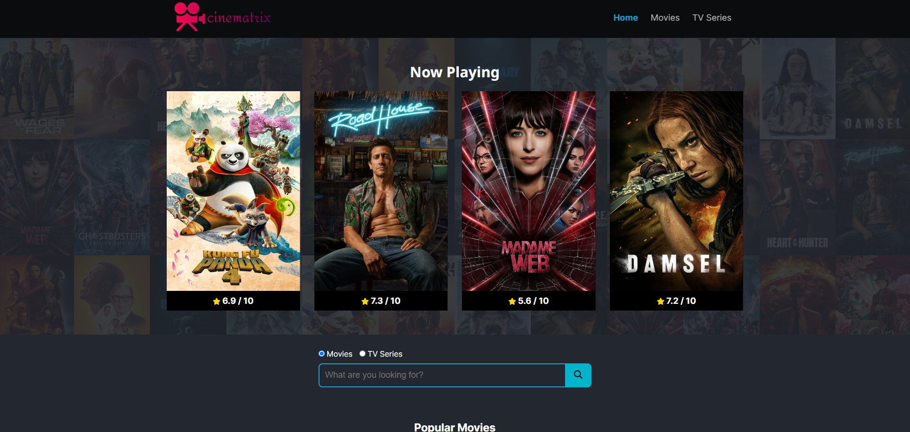
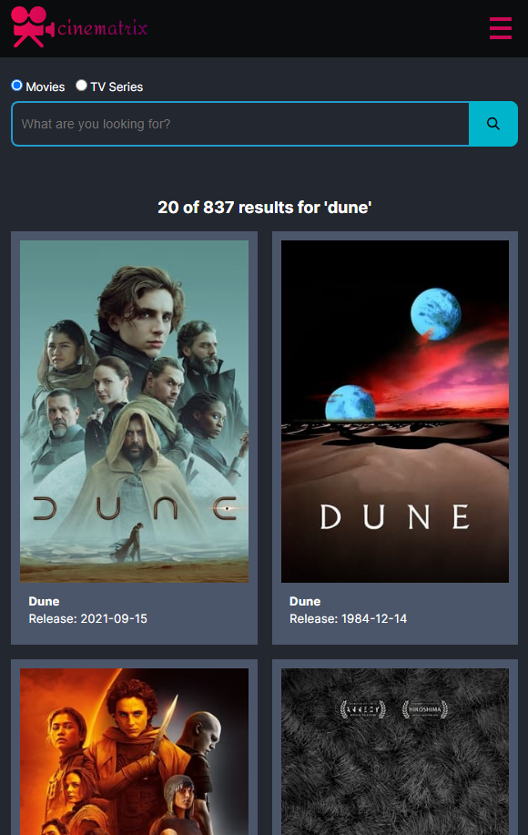
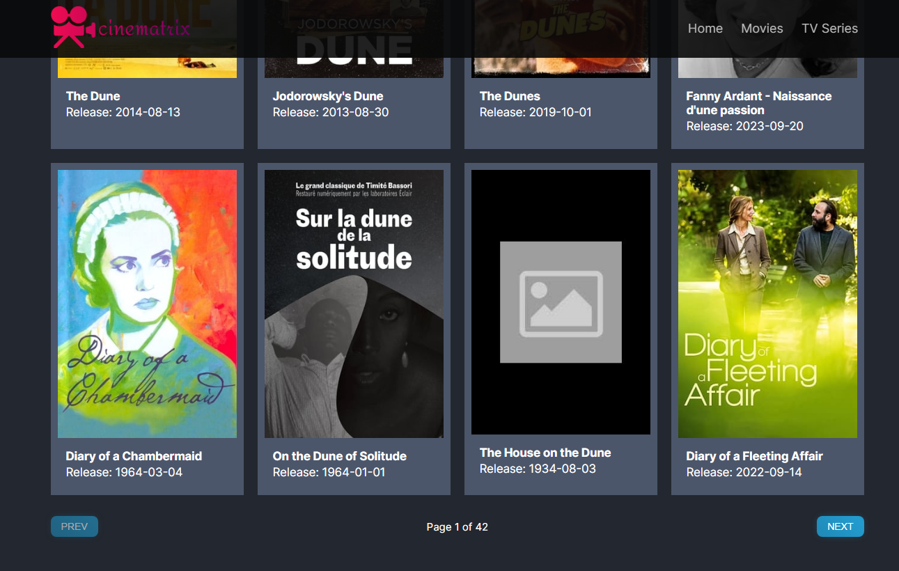
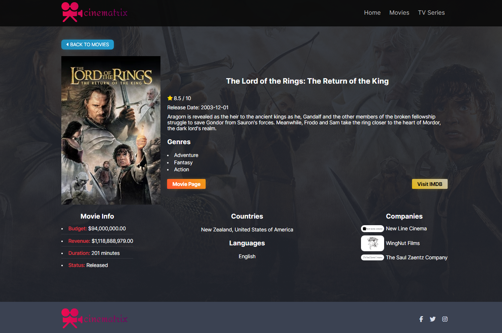

Cinematrix is a web application built with HTML, CSS, and JavaScript that allows users to explore currently playing movies, popular movies, and TV series. It utilizes the TMDB API to fetch movie and TV series data, and incorporates the JS Swiper library for smooth carousel effects.

## Features

- Currently Playing Movies: Displays a list of movies currently playing in theaters.

- Popular Movies: Showcases a collection of popular movies.

<p align="center">
    
</p>

- Search Functionality: Users can search for specific movies or TV series by typing in keywords.

<p align="center">
    
</p>

- Pagination: Search results are paginated, allowing users to navigate between multiple pages of results.

<p align="center">
    
</p>

- Upcoming Movies and Popular TV Series: Users can easily access upcoming movies or popular TV series by clicking on the respective headers.

- Detailed Content Pages: Each movie or TV series has its own detailed page with information such as overview, official page link, IMDb link, budget, revenue, release date, languages, and production companies.

<p align="center">
    
</p>

## Dependencies

[TMDb API](https://www.themoviedb.org/): Cinematrix fetches movie and TV series data from the TMDb API.

[JS Swiper Library](https://swiperjs.com/): Swiper is used to create smooth carousel effects for displaying movie and TV series posters.

## Usage

Clone the repository to your local machine.

```bash
git clone https://github.com/halil-yesilyurt/cinematrix
```

### API setup (Vercel)

The browser calls `/api/tmdb`. A serverless function forwards **approved** requests to TMDb using the `TMDB_API_KEY` environment variable. **Do not put API credentials into `script/app.js`, browser HTML, or the Git repository.**

1. Obtain or rotate the TMDb API v3 key from your TMDb account's **Settings → API**.
2. In the **Cinematrix Vercel project**, add `TMDB_API_KEY` to the appropriate environment(s), and redeploy so the serverless function receives it.
3. Visit `/api/tmdb?path=movie/popular` on your deployed project to check that the proxy returns movie data. Without the variable, the endpoint returns HTTP 503.
4. The API proxy does not run by double-clicking `index.html`. Run the site through a deployment/runtime that supports serverless functions (for local development, use a Vercel-compatible dev server).

If a key was previously committed to public source, **remove or revoke it in your TMDb account**; deleting it from the latest code does not erase Git history or previously published bundles.

Explore currently playing movies, popular movies, and TV series. Use the search functionality to find specific movies or TV series.

## Contributing

Contributions are welcome! If you'd like to contribute to Cinematrix, feel free to fork this repository and submit a pull request with your changes.
